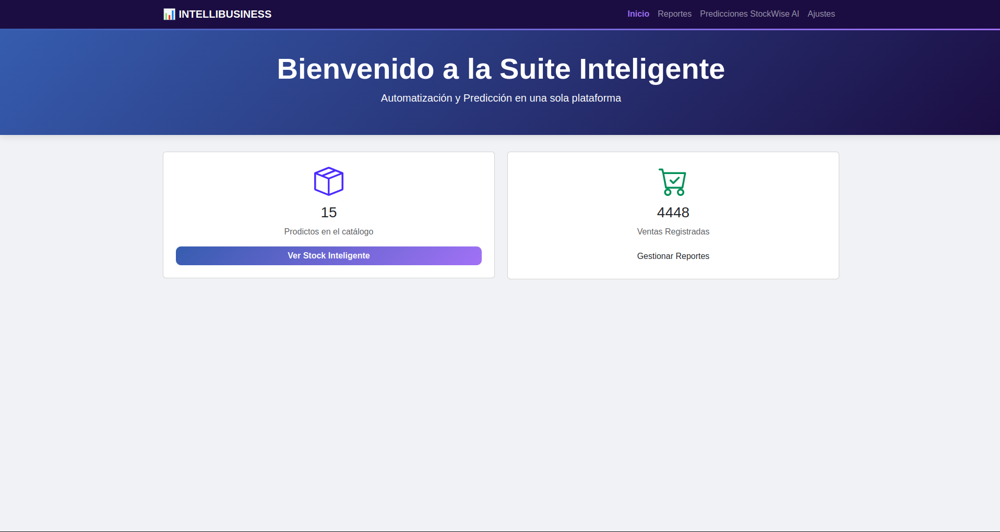
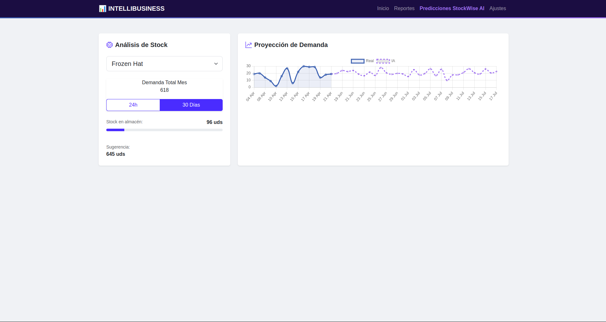
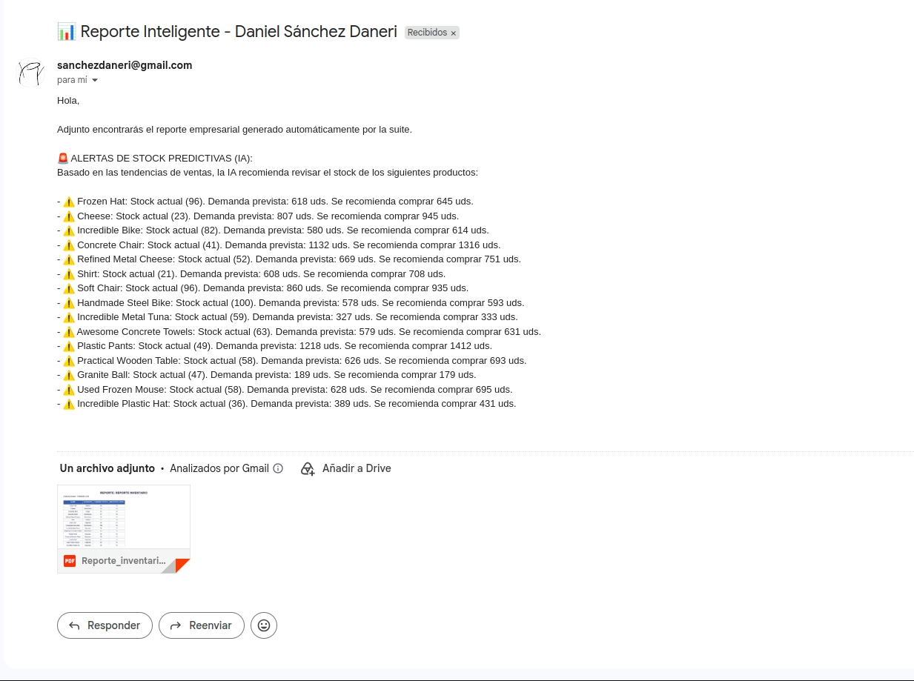

# 📊 IntelliBusiness Suite


Ecosistema integral **Full-Stack** de Inteligencia de Negocio y Automatización (BPA & BI). Esta Suite unifica el motor de reportes automatizados **BPAR** con la capacidad predictiva de **StockWise AI**, ofreciendo una solución única para la gestión de datos, proyecciones de demanda y optimización de inventarios.

---

## 🚀 Propuesta de Valor

IntelliBusiness Suite transforma los datos crudos de una empresa en una ventaja competitiva. Mientras que los sistemas tradicionales solo muestran el pasado, esta Suite:
1. **Automatiza el Presente:** Genera y distribuye reportes profesionales sin intervención humana.
2. **Predice el Futuro:** Utiliza Machine Learning para proyectar la demanda del próximo mes.
3. **Prescribe Acciones:** Recomienda compras exactas de stock basadas en el análisis de riesgo.

---

## ✨ Funcionalidades Premium

✅ **Automatización Híbrida:** Robot programador (Scheduler) que envía correos diarios incluyendo reportes históricos y alertas predictivas de la IA.  
✅ **Cerebro Predictivo:** Modelo de **Random Forest** entrenado para detectar tendencias y estacionalidad con una precisión (MAE) de ~1.5 unidades.  
✅ **Visualización Avanzada:** Dashboard interactivo con **Chart.js** que permite conmutar entre horizontes de predicción de 24 horas y 30 días.  
✅ **Asistente de Compra Inteligente:** Lógica de "Stock de Seguridad" que genera sugerencias de pedido automáticas y alertas visuales de rotura de stock.  
✅ **Generación Multiformato:** Creación de informes profesionales en **Excel (.xlsx)** y **PDF (.pdf)** con diseño corporativo y formatos automáticos.  
✅ **Control Total sin Código:** Panel de ajustes dinámico para gestionar destinatarios, horarios, márgenes de stock y columnas de datos desde la web.

---

## 📸 Galería del Sistema

### 🖥️ Dashboard de Operaciones e IA
Visualización unificada de la tendencia histórica y proyecciones dinámicas de la Inteligencia Artificial.


### 🤖 Inteligencia de Inventario
Semáforo de estado y asistente de compra prescriptivo basado en la predicción mensual.


### 📧 Automatización Híbrida (Email)
Recepción de informes con alertas inteligentes inyectadas directamente en el cuerpo del mensaje.


---

## 🏗️ Arquitectura del Ecosistema

```text
[ Usuario ] <───► [ Dashboard Web ] ◄───► [ Panel de Control ]
                           │                      │
                           ▼                      ▼
[ FastAPI ] ◄───► [ Background Tasks ] ◄───► [ settings.json ]
      │                    │                      │
      ▼                    ▼                      ▼
[ SQL DB ] ───► [ Pandas & ML Engine ] ───► [ PDF/Excel ] ───► [ Email SMTP ]
```

## 📂 Estructura del Proyecto
```text
├── app/
│   ├── ai/                 # 🧠 Modelos y Lógica de Machine Learning
│   │   ├── trainer.py            # Script de entrenamiento y evaluación
│   │   ├── predictor.py          # Motor de inferencia recursiva
│   │   └── model_store/          # Modelos serializados (.pkl)
│   ├── services/           # ⚙️ Lógica de Negocio
│   │   ├── report_service.py     # Orquestador de informes dinámicos
│   │   ├── ai_service.py         # Análisis de stock y predicción
│   │   ├── email_service.py      # Comunicación SMTP asíncrona
│   │   └── scheduler_service.py  # Programación de tareas híbridas
│   ├── utils/              # 🛠️ Generadores de archivos (Excel/PDF)
│   ├── templates/          # 📄 Vistas Web (Jinja2)
│   ├── static/             # 🎨 Identidad Visual (CSS Tech)
│   ├── main.py             # Punto de entrada y Ciclo de Vida
│   ├── models.py           # Esquema relacional unificado
│   └── config.py           # Validador de configuración (Pydantic)
├── config/                 # Ajustes persistentes del usuario
├── data/                   # Base de datos SQLite local (se crea sola, no se versiona)
├── reports/                # Historial cronológico de archivos generados
├── tests/                  # 🧪 Suite de tests automatizados (pytest)
├── scripts/manual_checks/  # Scripts de comprobación manual (envían email, usan la BD real...)
├── docs/                   # Documentación visual
├── .github/workflows/      # CI: tests + build de la imagen Docker
├── Dockerfile              # Imagen de la aplicación
├── docker-compose.yml      # App + PostgreSQL
├── .env.example            # Plantilla de secretos
├── seed_suite.py           # Generador de datos de demo (¡borra los datos existentes!)
├── run.sh                  # Script de arranque rápido profesional
├── requirements.txt        # Dependencias de producción
├── requirements-dev.txt    # Dependencias de desarrollo (pytest, httpx)
└── README.md               # Documentación maestra
```

### 🛠️ Stack Tecnológico
- Backend: Python 3.12, FastAPI, SQLAlchemy (ORM).
- IA/ML: Scikit-Learn (Random Forest), Pandas, NumPy, Joblib.
- Frontend: Jinja2, Bootstrap 5, Chart.js, JavaScript (Fetch API).
- Automatización: APScheduler, FastAPI-Mail.
- Formateo: Openpyxl (Excel), ReportLab (PDF).
 
### ⚙️ Instalación y Puesta en Marcha
Clonar y Entorno:
```code
Bash
git clone https://github.com/tu-usuario/intellibusiness-suite.git
cd intellibusiness-suite
python -m venv venv
source venv/bin/activate
pip install -r requirements.txt
```

Configuración de Secretos:
- Crea un archivo `.env` basado en `.env.example.`
- Define tus credenciales SMTP y de Base de Datos.

Inicialización e IA:
```code
Bash
python seed_suite.py   # Generar datos históricos inteligentes
python -m app.ai.trainer   # Entrenar al cerebro de la Suite
```

Ejecutar Suite:
```code
Bash
./run.sh
```

### 🐳 Con Docker (app + PostgreSQL)
```bash
cp .env.example .env          # rellena POSTGRES_PASSWORD (y los datos SMTP para enviar emails)
docker compose up --build

# Primera vez: datos de demo + entrenar el modelo de IA (el seed BORRA los datos existentes)
docker compose exec app python seed_suite.py
docker compose exec app python -m app.ai.trainer
```
La app queda en `http://localhost:8000`. Las tablas se crean al arrancar. Dentro de Docker,
`DB_TYPE=postgresql` y `POSTGRES_HOST=db` tienen prioridad sobre `config/settings.json`.
Hasta que entrenes el modelo, la página de predicciones responde con un aviso (HTTP 503) en lugar de romper la app.

### 🧪 Tests
```bash
pip install -r requirements-dev.txt
python -m pytest
```
Los tests usan SQLite en memoria y entrenan un modelo pequeño en una carpeta temporal, así que no tocan
tus datos, tu modelo real ni envían correos. GitHub Actions los ejecuta en cada push y pull request.

## 📓 Notas de Desarrollo
Esta Suite representa la culminación de un proceso de ingeniería de 15 días, integrando principios de Arquitectura Limpia, Análisis Prescriptivo y UX Centrada en el Negocio. Diseñada para ser escalable, segura y, sobre todo, útil para la toma de decisiones estratégicas.
Desarrollado por Daniel Sánchez Daneri
code
Code
